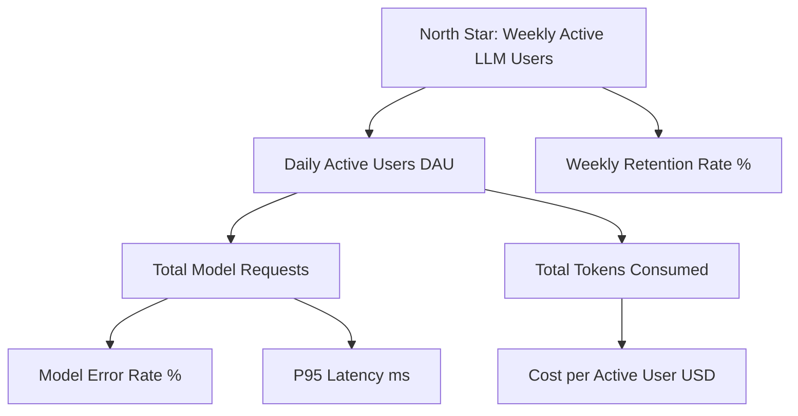

# ai-analytics-pipeline

[](https://github.com/bighnaraj2008-ai/ai-analytics-pipeline/actions/workflows/ci.yml)
[](https://github.com/bighnaraj2008-ai/ai-analytics-pipeline/actions/workflows/lint.yml)
[](LICENSE)
[](https://www.postgresql.org/)

Production-grade, **pure SQL** analytics pipeline for LLM/AI usage telemetry, built on Dockerized PostgreSQL with dimensional modeling (staging → intermediate → marts), automated SQL schema assertions, and a comprehensive metric dictionary.

> **Pure SQL only.** All transformations and sessionization algorithms are implemented natively in PostgreSQL. No Python or Spark dependencies are required for data transformations.

---

## Architecture Overview

```
raw_users, raw_ai_events          -- seed (source layer)
        │
        ▼
sql/staging/                      -- stg_users, stg_ai_events, stg_model_requests, stg_feedback
        │
        ▼
sql/intermediate/                 -- int_session_metrics, int_token_aggregates, int_user_activity, int_user_retention
        │
        ▼
sql/marts/                        -- dim_users, dim_models, fct_ai_usage_daily, fct_user_sessions, agg_monthly_costs
```

| Layer | Purpose | Key Models |
|-------|---------|------------|
| **Source** | Raw event ingestion | `raw_users`, `raw_ai_events` |
| **Staging** | Clean, cast, rename | `stg_users`, `stg_ai_events`, `stg_model_requests`, `stg_feedback` |
| **Intermediate** | Sessionization & logic | `int_session_metrics`, `int_token_aggregates`, `int_user_activity`, `int_user_retention` |
| **Marts** | Dimensions & Facts | `dim_users`, `dim_models`, `fct_ai_usage_daily`, `fct_user_sessions`, `agg_monthly_costs`, `agg_model_performance`, `fct_user_retention_cohorts` |

---

## Metrics Hierarchy



---

## Directory Layout

```
ai-analytics-pipeline/
├── .github/
│   └── workflows/
│       ├── ci.yml                          # Continuous integration pipeline
│       └── lint.yml                        # SQLFluff code quality checks
├── docker/
│   ├── docker-compose.yml                  # PostgreSQL service definition
│   └── init.sql                            # DB init & performance extensions
├── docs/
│   ├── ARCHITECTURE.md                     # Dimensional architecture guide
│   ├── BENCHMARK_TEMPLATE.md               # Execution benchmark template
│   ├── DATA_GOVERNANCE.md                  # Quality SLAs & retention policy
│   ├── FAQ.md                              # Frequently asked questions
│   ├── METRICS_DICTIONARY.md               # Metrics formula definitions
│   ├── METRICS_TREE.mmd                    # Mermaid metrics hierarchy diagram
│   ├── PERFORMANCE_TUNING.md               # Index & memory tuning guide
│   └── TROUBLESHOOTING.md                  # Connection & test resolution guide
├── examples/
│   ├── cost_attribution_report.sql        # Multi-tenant token attribution
│   ├── executive_dashboard.sql             # Executive reporting metrics
│   └── sample_queries.sql                  # General exploratory SQL
├── scripts/
│   ├── reset_db.sh                         # Schema reset automation
│   ├── run_pipeline.sh                     # Sequential pipeline runner
│   ├── run_tests.sh                        # Assertion test runner
│   ├── smoke_test.sql                      # Pre-flight health checks
│   └── validate_warehouse.sh               # Complete warehouse validation
├── sql/
│   ├── intermediate/                       # Sessionization & aggregates
│   ├── marts/                              # Dimensions and fact tables
│   ├── staging/                            # Cleaned staging views
│   ├── tests/                              # Schema assertion tests
│   ├── utils/                              # Permissions & vacuum scripts
│   └── seed_raw_events.sql                 # Synthetic raw telemetry seed
├── .dockerignore
├── .gitignore
├── .sqlfluff
├── CHANGELOG.md
├── CONTRIBUTING.md
├── Dockerfile
├── LICENSE
├── README.md
└── SECURITY.md
```

---

## Local Setup (Docker)

### 1. Boot PostgreSQL

```bash
cd docker
docker compose up -d
```

### 2. Run Pipeline & Quality Tests

```bash
bash scripts/run_pipeline.sh
bash scripts/run_tests.sh
```

---

## Continuous Integration

Every push to `main` executes `.github/workflows/ci.yml`:
1. Launches PostgreSQL 15 service container.
2. Seeds raw mock events.
3. Compiles staging, intermediate, and marts layers.
4. Executes all schema and quality assertion tests with `ON_ERROR_STOP=1`.

---

## License

This project is licensed under the MIT License - see the [LICENSE](LICENSE) file for details.
